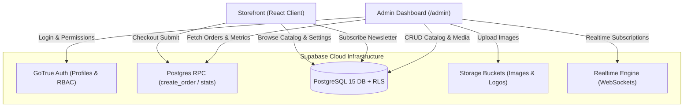
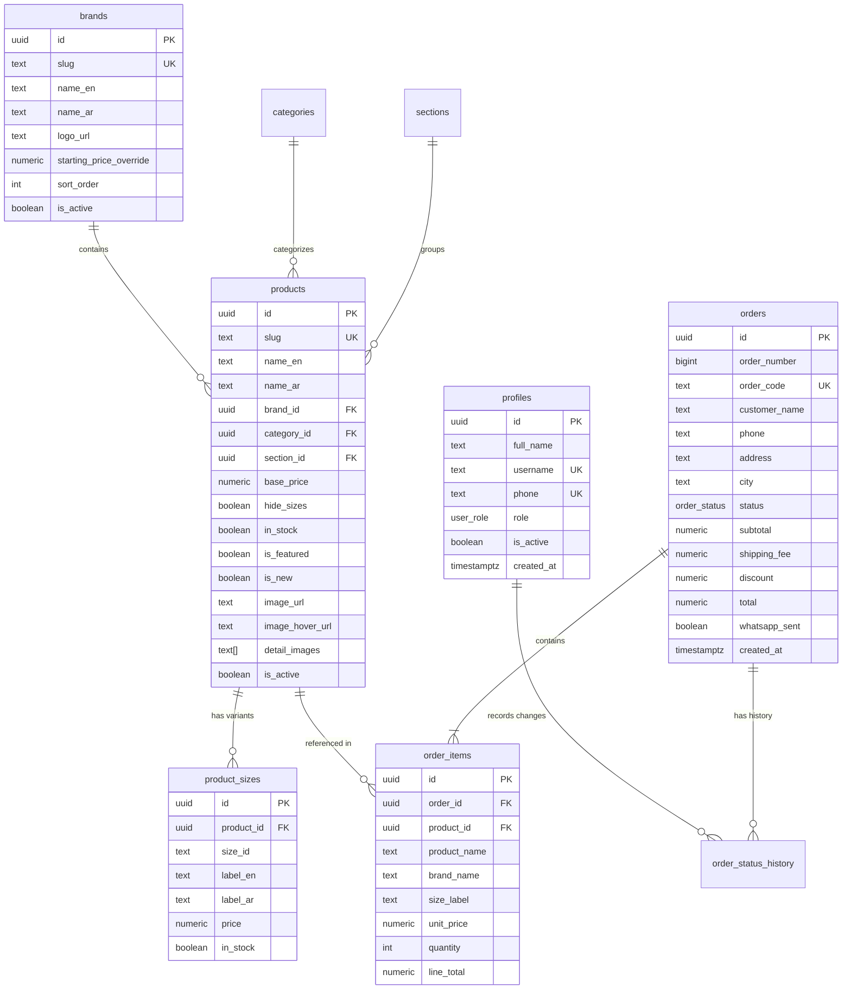

# توثيق الباك إند الشامل — Lithioo Perfumes Backend Documentation
## Supabase (PostgreSQL 15 + Auth + Storage + Realtime + RLS)

> **Lithioo Perfumes** — نظام إدارة وقاعدة بيانات متجر العطور الفاخرة ولوحة التحكم الإدارية.
> يعتمد النظام على منصة **Supabase** لتوفير بنية سحابية متكاملة وسريعة وآمنة.
> يوجد ملف التوثيق أيضاً داخل مجلد الباك إند في: [`supabase/README.md`](supabase/README.md).

---

## 📑 فهرس المحتويات | Table of Contents
1. [نظرة عامة على المعمارية (Architecture Overview)](#1-نظرة-عامة-على-المعمارية-architecture-overview)
2. [بيئة العمل والربط (Environment Variables)](#2-بيئة-عمل-المشروع-والربط-environment-variables)
3. [مخطط قاعدة البيانات (Database Schema & ERD)](#3-مخطط-قاعدة-البيانات-database-schema--erd)
4. [الجداول وسجل البيانات (Tables Reference)](#4-الجداول-وسجل-البيانات-tables-reference)
5. [الدوال المخزنة (RPC Functions)](#5-الدوال-المخزنة-rpc-functions)
6. [نظام الحماية وسياسات الأمان (Row Level Security - RLS)](#6-نظام-الحماية-وسياسات-الأمان-row-level-security---rls)
7. [مساحات التخزين وحاويات الصور (Storage Buckets)](#7-مساحات-التخزين-وحاويات-الصور-storage-buckets)
8. [خطوات الإعداد والتهيئة خطوة بخطوة (Setup Guide)](#8-خطوات-الإعداد-والتهيئة-خطوة-بخطوة-setup-guide)
9. [استيراد البيانات الأولية (Data Seeding)](#9-استيراد-البيانات-الأولية-data-seeding)
10. [إنشاء حسابات الإدارة والصلاحيات (Admin Management)](#10-إنشاء-حسابات-الإدارة-والصلاحيات-admin-management)
11. [استكشاف الأخطاء وحلها (Troubleshooting & FAQs)](#11-استكشاف-الأخطاء-وحلها-troubleshooting--faqs)

---

## 1. نظرة عامة على المعمارية (Architecture Overview)

تم تصميم الباك إند ليحقق ثلاثة أهداف رئيسية:
1. **أداء فائق وحماية متكاملة:** التحقق من الأسعار والعمليات الحساسة من جهة الخادم (Server-Side) عبر PostgreSQL Functions، مع تفعيل حماية RLS على كل جدول.
2. **العمل الهجين (Hybrid Fallback):** إذا لم تتوفر مفاتيح Supabase أو انقطع الاتصال، يعمل المتجر تلقائياً بنظام Static Data دون أي انهيار، بينما تعمل لوحة التحكم الإدارية `/admin` بمجرد توفر الاتصال.
3. **تزامن حي وفوري (Realtime Synchronization):** يتم استقبال الطلبات الجديدة لحظياً عبر Supabase Realtime داخل لوحة تحكم الطلبات مع تنبيهات Toast فورية وبدون الحاجة لعمل Reload.



---

## 2. بيئة عمل المشروع والربط (Environment Variables)

### بيانات مشروع Supabase الفعلي:
* **Project URL:** `https://xkpcfdacdwtihtpotdbp.supabase.co`
* **Project Reference ID:** `xkpcfdacdwtihtpotdbp`
* **Publishable / Anon Key:** `sb_publishable_03sk7OtgPlcBOukevWECcQ_JH5RciqP`

### إعداد ملفات البيئة:

#### 1. ملف الفرونت إند (`.env` أو `.env.local`):
يُستخدم في تطبيق المتجر ولوحة الإدارة:
```bash
REACT_APP_SUPABASE_URL=https://xkpcfdacdwtihtpotdbp.supabase.co
REACT_APP_SUPABASE_PUBLISHABLE_KEY=sb_publishable_03sk7OtgPlcBOukevWECcQ_JH5RciqP
REACT_APP_AUTH_EMAIL_DOMAIN=lithioo.app
```

#### 2. مفتاح السيرفر السري (`SUPABASE_SECRET_KEY`):
> ⚠️ **تنبيه أمني هام جداً:**
> مفتاح `service_role` أو `secret key` **ممنوع نهائياً** تضمينه داخل ملفات الفرونت إند أو رفعه على Git.
> يُستخدم هذا المفتاح حصراً في موجه الأوامر المحلي عند تشغيل سكريبتات ملء البيانات (Seeding):
```powershell
# في ويندوز PowerShell
$env:SUPABASE_SECRET_KEY="sb_secret_your_service_role_key_here"
node scripts/seed-supabase.mjs
node scripts/seed-products-full.mjs
```

---

## 3. مخطط قاعدة البيانات (Database Schema & ERD)



---

## 4. الجداول وسجل البيانات (Tables Reference)

قاعدة البيانات تحتوي على 13 جدولاً مصممة بدقة ومفهرسة لسرعة البحث:

| اسم الجدول | الوصف | الصلاحيات الافتراضية (RLS) |
|---|---|---|
| `profiles` | ملفات المستخدمين المرتبطة بـ `auth.users` وتحديد دور كل شخص (`admin`, `manager`, `staff`). | قراءة الملف الشخصي للمستخدم، تعديل كامل للأدمن فقط. |
| `categories` | تصنيفات المنتجات (mens-fragrance, womens-fragrance, unisex-fragrance, body-care). | قراءة للجميع، تعديل للمدير والأدمن. |
| `sections` | أقسام المتجر (men, women, special, original, new-luxury, new-diverse). | قراءة للجميع، تعديل للمدير والأدمن. |
| `brands` | العلامات التجارية (اللوجو، الاسم عربي/إنجليزي، الترتيب، وأقل سعر افتراضي). | قراءة النشطة للجميع، إدارة كاملة للمديرين. |
| `products` | كتالوج العطور بجميع بياناته، النوتات العطرية، الفوائد، التقييم، والصور. | قراءة المنتجات المفعلة، إدارة كاملة للمديرين. |
| `product_sizes` | أحجام وأسعار العطور المرتبطة بكل منتج (30ml = 300, 50ml = 450, 100ml = 650... إلخ). | قراءة للجميع، تعديل للمدير والأدمن. |
| `hero_slides` | شرائح السلايدر الرئيسي للمتجر (نسخة سطح المكتب + نسخة الموبايل + النصوص). | قراءة للنشط فقط، تعديل للمديرين. |
| `customer_reviews` | آراء وتقييمات العملاء وصور التجارب. | قراءة للنشط فقط، تعديل للمديرين. |
| `orders` | طلبات الشراء الواردة، رقم الطلب التسلسلي ورقم الطلب التنسيقي المولد تلقائياً `order_code` (مثل `LTH-000123`). | إنشاء عبر RPC فقط، قراءة وتحديث للموظفين المصرح لهم. |
| `order_items` | تفاصيل أصناف الطلب مع أخذ لقطة ثنائية (Snapshot) للسعر واسم الصنف وقت الشراء. | قراءة للموظفين المصرح لهم فقط. |
| `order_status_history` | السجل الزمني لحالات الطلب مع trigger آلي يسجل أي تغيير في الحالة مع هوية الموظف. | قراءة للموظفين، وتسجيل التغييرات تلقائياً. |
| `newsletter_subscribers` | المشتركون في النشرة البريدية للمتجر مع فحص لصحة البريد الإلكتروني. | إضافة مجهولة (Anon Insert)، استعراض للموظفين، حذف للمديرين. |
| `site_settings` | إعدادات الموقع المركزية (رقم الواتساب، رقم الهاتف، تكلفة الشحن، العناوين...). | قراءة للجميع (للمفاتيح العامة)، تعديل للأدمن فقط. |

---

## 5. الدوال المخزنة (RPC Functions)

تم تزويد قاعدة البيانات بدوال أمان رئيسية تعمل بصلاحيات `SECURITY DEFINER`:

### 1. دالة إنشاء الطلب: `create_order(payload JSONB)`
* **الهدف:** استلام الطلب من العميل وإعادة حساب جميع الأسعار من قاعدة البيانات مباشرة لمنع أي تلاعب محلي في الأسعار، والتحقق من صحة رقم الهاتف المصري.
* **المدخلات (JSONB):**
```json
{
  "customer_name": "أحمد محمود",
  "phone": "01064307053",
  "address": "شارع الجمهورية",
  "city": "بني سويف",
  "notes": "الرجاء الاتصال قبل التوصيل",
  "language": "ar",
  "items": [
    {
      "product_slug": "nl-pink-diamond-sakura",
      "size_id": "100ml",
      "quantity": 2
    }
  ]
}
```
* **المخرجات (JSONB):**
```json
{
  "order_id": "d7a456bc-1234-5678-90ab-cdef12345678",
  "order_number": 123,
  "order_code": "LTH-000123",
  "subtotal": 1300.00,
  "shipping_fee": 0,
  "total": 1300.00
}
```

### 2. دالة تتبع تغيير الحالات (Trigger Function): `log_order_status_change`
* **الهدف:** عند تحديث عمود `status` في جدول `orders`، يقوم الـ Trigger تلقائياً بإدراج سجل في جدول `order_status_history` موثقاً فيه المستخدم `auth.uid()` والحالة الجديدة والتاريخ.

### 3. دالة إحصائيات لوحة التحكم: `admin_dashboard_stats(p_from, p_to)`
* **الهدف:** حساب جميع مؤشرات الأداء الحيوية (KPIs) في استعلام خادم واحد فائق السرعة لدعم لوحة الإدارة.
* **المعاملات:** `p_from TIMESTAMPTZ`, `p_to TIMESTAMPTZ` (افتراضياً آخر 30 يوماً).
* **المخرجات:**
  - `revenue`: إجمالي المبيعات بالجنيه المصري (بدون الملغاة).
  - `orders_count`: إجمالي عدد الطلبات.
  - `avg_order_value`: متوسط قيمة الطلب.
  - `new_customers`: عدد العملاء الجدد الفريدين.
  - `new_orders`: عدد الطلبات الجديدة بحالة `new`.
  - `out_of_stock`: عدد المنتجات غير المتوفرة بالمخزون.
  - `orders_by_status`: توزيع الطلبات بحسب الحالة (لرسم مخطط الدونات).
  - `daily_revenue`: الإيرادات المجمعة يومياً مع عدد الطلبات (لرسم الخط البياني التفاعلي).
  - `top_products`: أكثر 5 منتجات مبيعاً من حيث الكمية والقيمة.
  - `top_brands`: أكثر 5 علامات تجارية مبيعاً.

---

## 6. نظام الحماية وسياسات الأمان (Row Level Security - RLS)

جميع الجداول مفعل عليها الـ RLS لحماية البيانات عبر دوال فحص الصلاحيات المركزية:
- `is_staff()`: للأدمن والمديرين والموظفين.
- `is_manager()`: للأدمن والمديرين.
- `is_admin()`: للأدمن فقط.

1. **الكتالوج العام (`products`, `brands`, `categories`, `sections`, `product_sizes`):**
   - قراءة مفتوحة للزوار للبيانات النشطة (`is_active = true`).
   - الإضافة، التعديل، والحذف مقتصرة فقط على المديرين والأدمن (`is_manager()`).

2. **الطلبات (`orders`, `order_items`, `order_status_history`):**
   - العميل العادي لا يملك صلاحية القراءة المباشرة من الجدول (لحماية خصوصية العملاء).
   - الإنشاء يتم حصرياً عبر الـ RPC `create_order`.
   - استعراض وتحديث الطلبات مقتصر على طاقم العمل المصرح له (`is_staff()`).

3. **النشرة البريدية (`newsletter_subscribers`):**
   - إضافة مجهولة آمنة للزوار للاشتراك عبر البريد.
   - الاستعراض لطاقم العمل، والحذف للمديرين فقط.

4. **إعدادات الموقع وملفات الإدارة (`site_settings`, `profiles`):**
   - التعديل محمي ومخصص فقط لمدير النظام الرئيسي (`is_admin()`).

---

## 7. مساحات التخزين وحاويات الصور (Storage Buckets)

يتم إنشاء الحاويات الـ 4 التالية تلقائياً بواسطة سكريبت الترحيل (`0001_initial_schema.sql`):

| اسم الـ Bucket | الاستخدام | سياسة القراءة | سياسة الكتابة والتعديل |
|---|---|---|---|
| `product-images` | صور المنتجات الرئيسية ومعرض الصور الإضافية | عام (Public Read) | المديرون فقط (`is_manager()`) |
| `brand-logos` | شعارات الماركات والعلامات التجارية | عام (Public Read) | المديرون فقط (`is_manager()`) |
| `hero` | بنرات وسلايدر الواجهة الرئيسية | عام (Public Read) | المديرون فقط (`is_manager()`) |
| `reviews` | صور وتجارب وآراء العملاء | عام (Public Read) | المديرون فقط (`is_manager()`) |

---

## 8. خطوات الإعداد والتهيئة خطوة بخطوة (Setup Guide)

### الخطوة 1: تطبيق ملفات الترحيل (Apply Migrations SQL)
1. افتح مشروعك في **[Supabase Dashboard](https://supabase.com/dashboard)**.
2. توجّه إلى القائمة الجانبية واختر **SQL Editor**.
3. **الملف الأول:** انسخ والصق محتوى [`supabase/migrations/0001_initial_schema.sql`](supabase/migrations/0001_initial_schema.sql) واضغط **Run**.
4. **الملف الثاني:** انسخ والصق محتوى [`supabase/migrations/002_username_auth.sql`](supabase/migrations/002_username_auth.sql) واضغط **Run**.
   - يضيف أعمدة `username` و `phone` و `is_active` إلى جدول `profiles`.
   - يحدّث دوال التحقق من الصلاحيات (`has_role`, `is_staff`, `is_admin`, `is_manager`) للتأكد من أن الحساب نشط `is_active = true`.

### الخطوة 2: نشر الـ Edge Function (`admin-users`)
لتمكين لوحة التحكم من إنشاء وتعديل وحذف الحسابات وتعيين كلمات المرور:
```bash
supabase functions deploy admin-users
```
> تأكد من ضبط سر `REACT_APP_AUTH_EMAIL_DOMAIN=lithioo.app` في إعدادات Functions إذا رغبت بنطاق مخصص.

---

## 9. استيراد البيانات الأولية (Data Seeding)

تم توفير سكريبتات Seeding جاهزة ومطابقة لكافة المنتجات (~286 عطر) والماركات والإعدادات الحالية. السكريبتات متكررة (Idempotent) وآمنة لإعادة التشغيل:

```powershell
# 1. عين المفتاح السري في الجلسة المحلية مؤقتاً:
$env:SUPABASE_SECRET_KEY="sb_secret_your_service_role_key_here"

# 2. ارفع الأقسام، الماركات، سلايدر الهيرو، المراجعات، والإعدادات:
node scripts/seed-supabase.mjs

# 3. ارفع كتالوج العطور كاملاً بجميع الأحجام والأسعار:
node scripts/seed-products-full.mjs
```

---

## 10. نظام الدخول وإدارة الفريق (Username Auth & Team Management)

### معمارية تسجيل الدخول باسم المستخدم:
* لا يدعم Supabase Auth تسجيل الدخول باسم المستخدم مباشرة؛ لذا يتم تحويل اسم المستخدم تلقائياً داخلياً إلى صيغة بريد إلكتروني مقترنة بنطاق المشروع: `${username.toLowerCase()}@lithioo.app`.
* المستخدم لا يرى ولا يكتب هذا البريد إطلاقاً؛ تسجيل الدخول يتم بالكامل عبر **اسم المستخدم + كلمة المرور**.
* تم إلغاء التسجيل العام ورابط استعادة كلمة المرور عبر البريد للعامة، واستبداله بتوجيه للتواصل مع مدير النظام.
* تم تفعيل حماية ضد التخمين (Throttle): بعد 5 محاولات خاطئة يتم إيقاف زر الدخول لمدة 30 ثانية مع عد تنازلي.

### إنشاء أول حساب مدير عام (Super Admin):
1. في Supabase Dashboard، اذهب إلى **Authentication** -> **Users**.
2. اضغط **Add User** -> **Create User** وأدخل:
   - البريد الإلكتروني: `admin@lithioo.app`
   - كلمة المرور: (اختر كلمة مرور قوية من 8 أحرف فأكثر)
   - فعّل خيار `Auto Confirm User`.
3. انتقل إلى **SQL Editor** ونفّذ الاستعلام التالي لربط اسم المستخدم وصلاحية المدير العام:

```sql
INSERT INTO public.profiles (id, full_name, username, phone, role, is_active)
SELECT id, 'Super Admin', 'admin', '01000000000', 'admin', true
FROM auth.users WHERE email = 'admin@lithioo.app'
ON CONFLICT (id) DO UPDATE SET
  username = 'admin',
  phone = '01000000000',
  role = 'admin',
  is_active = true;
```

4. الآن افتح لوحة التحكم:
   `http://localhost:3000/admin/login`
   - **اسم المستخدم:** `admin`
   - **كلمة المرور:** الكلمة التي اخترتها.

### إدارة الفريق من داخل لوحة التحكم (`/admin/team`):
* يستطيع المدير العام (Admin فقط) الدخول إلى صفحة `/admin/team`.
* **إضافة عضو جديد:** إدخال الاسم، اسم المستخدم (فريد 3-30 حرف)، رقم الهاتف المصري (`010/011/012/015`)، وتوليد كلمة مرور عشوائية مع زر نسخ مباشر، واختيار الصلاحية (`admin` / `manager` / `staff`).
* **إجراءات الحسابات:** تعديل البيانات، إعادة تعيين كلمة المرور، تفعيل/تعطيل الحساب فوراً، وحذف الحساب مع نافذة تأكيد، مع حظر تعطيل أو حذف المدير لنفسه.

---

## 11. استكشاف الأخطاء وحلها (Troubleshooting & FAQs)

### ❓ المشكلة 1: هل السكريبت آمن لإعادة التشغيل إذا كنت قد شغّلته سابقاً؟
* **الحل:** نعم، جميع الأوامر تستخدم `IF NOT EXISTS` و `OR REPLACE` و `ON CONFLICT DO UPDATE/NOTHING` و `DROP POLICY IF EXISTS`، مما يجعله متكرراً بنسبة 100% (Idempotent).

### ❓ المشكلة 2: ظهور صفحة 403 / "غير مصرح لك بالدخول" بعد تسجيل الدخول للوحة التحكم
* **الحل:** تأكد أن المستخدم مسجل داخل جدول `public.profiles` ويمتلك دور `admin` أو `manager` أو `staff`. إذا لم يكن موجوداً، قم بتنفيذ استعلام الترقية الموضح في القسم العاشر أعلاه.

### ❓ المشكلة 3: الطلبات الجديدة لا تظهر فوراً في جدول الطلبات
* **الحل:** يقوم السكريبت بتنفيذ `alter publication supabase_realtime add table public.orders;` تلقائياً. تأكد من أن الـ Realtime مفعل في مشروعك على Supabase.

### ❓ المشكلة 4: المتجر يعرض المنتجات من الملفات الثابتة بدلاً من Supabase
* **الحل:** تأكد من وجود ملف `.env` في جذر المشروع يحتوي على القيم الصحيحة:
  `REACT_APP_SUPABASE_URL` و `REACT_APP_SUPABASE_PUBLISHABLE_KEY`.
  ثم أعد تشغيل السيرفر المحلي بـ `npm start`.

---

**فريق التطوير — Lithioo Perfumes**
تم إعداد وتوثيق هذا الباك إند وفق أعلى معايير الأداء والأمان وقواعد البيانات السحابية الحديثة.
